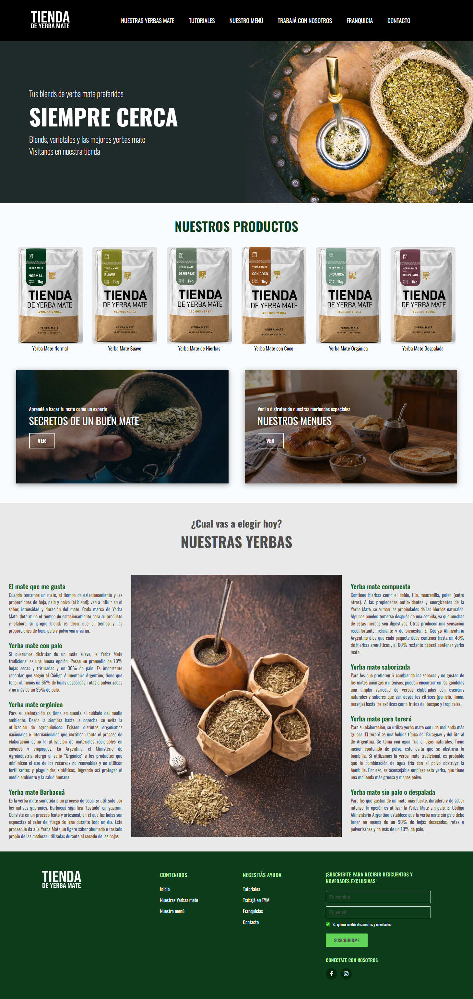

# Tienda de Yerba Mate

**Materia:** Desarrollo de sistemas WEB (Front End)  
**Trabajo práctico:** TPO 1 / Trabajo Práctico Grupal 1

## Descripción del proyecto

Sitio web desarrollado con HTML y CSS que adapta la estructura y los estilos generales de Tienda de Café a la temática de una tienda de yerba mate. Incluye una página de inicio, variedades de yerba, tutoriales, un menú de meriendas y secciones de trabajo, franquicias y contacto.

## Equipo

```json
{
  "equipo": [
    "Lucía Corral",
    "Pablo Demartini",
    "Carla Guisande",
    "Ignacio Hernández",
    "Ignacio Vidal"
  ]
}
```

## Consigna

Clonar la estructura, las fuentes y los estilos generales del sitio [Tienda de Café](https://tiendadecafe.com.ar/), adaptándolo a una nueva temática coherente. Se permite modificar el contenido y los colores principales y secundarios, manteniendo una interfaz elegante y profesional.

El objetivo del trabajo es aprender a clonar interfaces web y trabajar en equipo, reforzando la comunicación, la organización y el uso colaborativo de Git y GitHub, además de publicar una web que pueda formar parte del portfolio.

### Páginas requeridas

Se deben desarrollar siete páginas, excluyendo la sección Locales del sitio original:

| Página de referencia | Archivo en este proyecto |
| --- | --- |
| Inicio | `index.html` |
| Nuestro Café, adaptada a Nuestras Yerbas Mate | `html/nuestrasYerbas.html` |
| Tutoriales | `html/tutoriales.html` |
| Nuestro Menú | `html/menu.html` |
| Trabajá con Nosotros | `html/trabajoConNosotros.html` |
| Franquicias | `html/franquicia.html` |
| Contacto | `html/contacto.html` |

### Requisitos principales

- Organizar los archivos HTML, las hojas de estilo y las imágenes en carpetas con nombres y rutas correctos.
- Utilizar unidades relativas para los contenedores principales y Flexbox para distribuir y posicionar los elementos.
- Aplicar correctamente el modelo de caja: márgenes, bordes y padding, así como el manejo de elementos en bloque y en línea.
- Incorporar fuentes propias o de Google Fonts, tamaños relativos en mobile e iconos.
- Trabajar los enlaces con pseudoclases y utilizar combinadores CSS descendientes y directos.
- Adaptar el diseño a cuatro tamaños máximos de pantalla: 1080 px, 768 px, 480 px y 375 px.
- Mantener un código limpio, comentado e indentado, con bloques de CSS claramente separados.
- Compartir la navegación y el pie de página entre todas las páginas.
- Distribuir el trabajo de manera equilibrada entre los integrantes.

No es necesario reproducir todos los productos ni implementar el desplazamiento de las galerías: alcanza con imágenes de muestra y una portada estática. Se valoran los efectos al pasar el mouse y, de forma opcional, un README con una descripción y una imagen del sitio.

## Vista de la página de inicio



## Árbol de carpetas

```text
Tienda-Yerba-Mate/
├── index.html
├── README.md
├── css/
│   ├── paginas.css
│   └── styles.css
├── html/
│   ├── contacto.html
│   ├── franquicia.html
│   ├── menu.html
│   ├── nuestrasYerbas.html
│   ├── trabajoConNosotros.html
│   └── tutoriales.html
└── img/
    ├── home.png
    ├── LogoTiendaYerbaMate.png
    └── ... (imágenes de productos, fondos y tutoriales)
```

## Cómo ver el proyecto

Abrí `index.html` en un navegador para recorrer el sitio.
